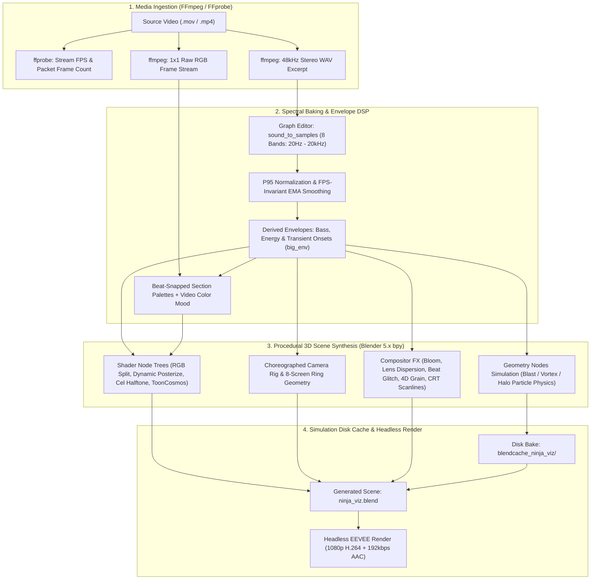

# Ninja-Viz 🥷 🎥

[-EA7600?logo=blender&logoColor=white)](https://www.blender.org/)
[](https://docs.blender.org/manual/en/latest/render/eevee/index.html)
[](https://www.python.org/)
[](https://ffmpeg.org/)
[](https://www.youtube.com/watch?v=POsh-u5hneM&list=PLQtoqjXEFKc8&index=1)

**100% code-driven, audio-reactive 3D cel-shaded music video synthesizer built on Blender 5.x (`bpy`) and FFmpeg.**

`ninja-viz` ingests any music video file, decomposes its audio into 8 logarithmic frequency bands (`20 Hz` – `20 kHz`), extracts per-frame chromatic mood, and procedurally constructs an entire 3D audiovisual stage from scratch—generating meshes, shader node graphs, Geometry Nodes particle simulations, camera choreography, and post-processing compositor pipelines without a single pre-baked `.blend` asset.

---

## 🎬 Generated Video Showcase

Watch full procedural music videos synthesized entirely by `ninja-viz` on YouTube:

| [](https://www.youtube.com/watch?v=POsh-u5hneM&list=PLQtoqjXEFKc8&index=1) | [](https://www.youtube.com/watch?v=G_bkbOIoyfM&list=PLQtoqjXEFKc8&index=3) |
| :---: | :---: |
| **[▶ Sunrise Music Video (Visual Remix)](https://www.youtube.com/watch?v=POsh-u5hneM&list=PLQtoqjXEFKc8&index=1)** | **[▶ AGI Sun — Procedural Music Video Experiment](https://www.youtube.com/watch?v=G_bkbOIoyfM&list=PLQtoqjXEFKc8&index=3)** |
| [](https://www.youtube.com/watch?v=O-S4EDn2eQg&list=PLQtoqjXEFKc8&index=4) | [](https://www.youtube.com/watch?v=GB9w3C5CHzc&list=PLQtoqjXEFKc8&index=5) |
| **[▶ Endor's Dream](https://www.youtube.com/watch?v=O-S4EDn2eQg&list=PLQtoqjXEFKc8&index=4)** | **[▶ I Am And It Is (Procedural Remix)](https://www.youtube.com/watch?v=GB9w3C5CHzc&list=PLQtoqjXEFKc8&index=5)** |

---

## ✨ Key Engineering Highlights

- **Zero-Asset Procedural 3D Synthesis**: Every mesh, material shader tree, world environment (`ToonSky` / `ToonCosmos`), Geometry Nodes particle simulation, camera rig, and compositor graph is built programmatically at runtime via Blender's Python API (`bpy`).
- **8-Band Spectral Baking & Transient Onset DSP**: Extracts 48 kHz stereo audio via `ffmpeg` and drives Blender's Graph Editor `sound_to_samples` across 8 octave bands (`20–60 Hz` sub-bass up to `10–20 kHz` brilliance). Signals are normalized against 95th-percentile energy (`P95`) and processed through FPS-invariant exponential moving averages (`BuildContext.per_frame`) to derive bass envelopes, global energy, and sharp transient onset triggers (`big_env`).
- **Beat-Quantized Palettes & Video Color Blending**: Streams a `1x1` raw RGB frame pipe from `ffmpeg` to track the source video's dominant color mood over time, blending it dynamically with 4 curated color palettes (*Sunset*, *Ice*, *Acid*, *Neon*) whose transitions snap to major beat onsets.
- **Multi-Mode Geometry Nodes Particle Physics**: Programmatically constructs a Blender Simulation Zone (`OrbParticles`) supporting 3 audio-cycled physics modes—**Blast** (radial impulse burst), **Vortex** (swirling orbital torque), and **Halo** (ring emission)—with multi-shape instancing (icospheres, cubes, diamonds), drag/gravity integration, and disk-baked simulation caches.
- **Audio-Reactive Shader & Compositor Pipelines**:
  - **Video & Cel Shaders**: Beat-driven UV chromatic RGB splitting, dynamic quantization/posterization levels, screen-space halftone shadow dots, and 4D Voronoi twinkling starfields.
  - **Post-Processing Stack**: Automated Blender Compositor graph combining bloom glare, lens chromatic dispersion, beat-triggered blocky UV glitch distortion, vignette, 4D animated film grain, and CRT scanlines.
- **Blender 5.x Native Architecture**: Built specifically for Blender 5.x's Slotted Action Channelbag animation system (`bpy_extras.anim_utils`) and EEVEE Next rendering pipeline.

---

## 🏗️ End-to-End Pipeline Architecture



---

## 🎨 Visual Templates

`ninja-viz` ships with a modular template registry (`templates/`) offering 4 distinct audiovisual stages:

| Template | Aesthetic | Centerpiece | World / Sky | Floor & Stands | Screen & Shader Behavior | Camera Choreography |
| :--- | :--- | :--- | :--- | :--- | :--- | :--- |
| **`main`** | **Classic Ring** | Simple Glowing Orb + Point Light | `ToonSky` vertical gradient | Cel checker floor + radial neon grid + stands | 8 outward-facing vertical screens; static 6-level posterized video | Off-center variable-speed orbiting camera (`55s` slow / `11s` fast lap) |
| **`new-viz`** | **Stage Ring** | Simple Glowing Orb + Halftone Cel Outlines | `ToonSky` + beat-snapped cycling palette hue shift | Cel checker floor + radial neon grid + stands | Outward-facing ring; dynamic RGB split + hue shift + beat posterize | Off-center orbit + `8s` breathing dolly + bass height bob |
| **`mainframe`** | **Space Mainframe** | **Mainframe Core** (plasma + 3 multi-axis gimbal torus rings + neon wireframe cage + 4 beat shooting streaks) | `ToonCosmos` drifting 3D noise nebula + halftone dots + dual-layer 4D Voronoi twinkling stars | *None* (floating in deep space) | Outward-facing ring; dynamic RGB split + hue shift + beat posterize | Center-locked reverse orbit + `8s` breathing dolly + bass height bob |
| **`vertical-drop`** | **Overhead Drop** | **Mainframe Core** (plasma + 3 multi-axis gimbal torus rings + neon wireframe cage + 4 beat shooting streaks) | `ToonCosmos` drifting 3D noise nebula + halftone dots + dual-layer 4D Voronoi twinkling stars | *None* (floating in deep space) | Synchronized upward `80°` tilt (`90° → 10°`) tracking overhead camera | `20s` periodic crane arc: eye-level (`0°`, `6.1m`) to top-down overhead (`90°`, `15.6m`) |

---

## 🚀 Prerequisites & Quick Start

### Prerequisites

- **Blender 5.x** installed at `/Applications/Blender.app/Contents/MacOS/Blender` (macOS default used by `render.sh`, or invoke `build_scene.py` directly with your platform's Blender binary).
- **FFmpeg & FFprobe** available on your system `PATH` (`brew install ffmpeg`).

### 1. Build and Render (One-Step Pipeline)

Run `render.sh` to extract audio, build the procedural `.blend` scene, bake sound F-Curves & particle caches, and launch the headless EEVEE render:

```bash
./render.sh --video Sunrise.mov --template vertical-drop
```

### 2. Custom Excerpts & Full Renders

Render a 30-second test excerpt starting at `1:00` (`60s`) with 15-second palette/particle section cycles:

```bash
./render.sh --video "Mainframe.mov" --template mainframe --start 60 --duration 30 --section 15
```

Render an entire full-length music video:

```bash
./render.sh --video "Wakeup Endor.mov" --template new-viz --full
```

### 3. Batch Render All 4 Templates

To render 30-second comparison cuts across all 4 templates (`main`, `new-viz`, `mainframe`, `vertical-drop`) sequentially:

```bash
./render_batch.sh
```

### 4. Interactive Build-Only (Inspect in Blender GUI)

To generate `ninja_viz.blend` and keep the Blender 5.x GUI open for real-time viewport inspection without starting the headless render:

```bash
/Applications/Blender.app/Contents/MacOS/Blender --factory-startup --python build_scene.py -- \
    --video Sunrise.mov --template vertical-drop --duration 10 --no-quit
```

---

## ⚙️ CLI Reference

| Argument | Description | Default |
| :--- | :--- | :--- |
| `--video PATH` | **(Required)** Path to source video file (`.mov`, `.mp4`, etc.) | *None* |
| `--template NAME` | **(Required)** Visual stage template: `main`, `new-viz`, `mainframe`, `vertical-drop` | *None* |
| `--start SECONDS` | Excerpt start timestamp in seconds | `0.0` |
| `--duration SECONDS` | Excerpt duration in seconds | `30.0` |
| `--section SECONDS` | Section interval in seconds for cycling color palettes and particle physics modes | `30.0` |
| `--full` | Override `--start` and `--duration` to synthesize the entire source video | `false` |
| `--out PATH` | Output path for the generated `.blend` file | `ninja_viz.blend` |
| `--no-quit` | Keep the Blender GUI window open after scene construction and baking finish | `false` |

---

## 📂 Project Architecture & Output Artifacts

```text
ninja-viz/
├── build_scene.py          # CLI entry point: orchestrates media probe, audio extraction, template build & particle bake
├── common.py               # Shared DSP & bpy utilities: ffprobe/ffmpeg wrappers, 1x1 RGB extraction, F-Curve baking, EEVEE setup
├── render.sh               # Two-stage runner: windowed Graph Editor F-Curve build + headless background render (-b -a)
├── render_batch.sh         # Batch orchestrator to render all 4 templates sequentially
├── templates/              # Modular procedural scene templates (each exposes build(scene, ctx, ov))
│   ├── __init__.py         # Template registry & lookup
│   ├── main.py             # Classic Ring template
│   ├── new_viz.py          # Stage Ring template (cycling palettes, halftone cel shadows, 3-mode particles)
│   ├── mainframe.py        # Space Mainframe template (ToonCosmos nebula, Mainframe Core gimbals, shooting streaks)
│   └── vertical_drop.py    # Overhead Drop template (20s overhead crane pitch arc + synchronized 80° screen tilt)
├── ninja_viz.blend         # [Generated] Self-contained procedural Blender 5.x scene artifact
├── audio_excerpt.wav       # [Generated] Extracted 48kHz stereo WAV audio stem
├── blendcache_ninja_viz/   # [Generated] Disk-baked Geometry Nodes particle simulation cache
└── renders/                # [Generated] Final 1080p H.264/AAC MP4 renders ({video}_{template}_{tag}_####.mp4)
```
